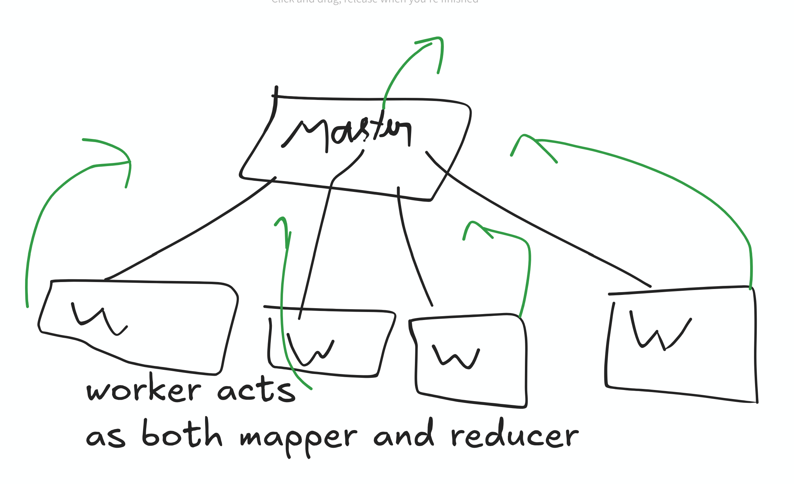
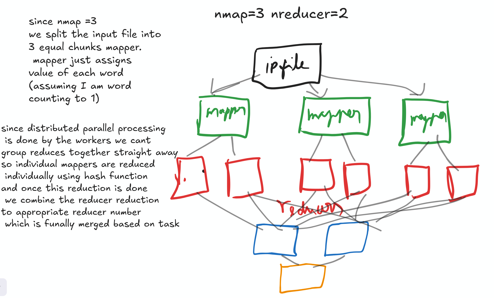

# distributed map reduce
https://frankeh.github.io/cu-ds1-2026-fall/

multiple standalone workers doing mapping and reducing as per the original map reduce paper
https://static.googleusercontent.com/media/research.google.com/en//archive/mapreduce-osdi04.pdf

read my breakdown of this in my paper reading blog 
https://www.thisisvoid.in/blogs/2026_09/paper_reading/mpr

